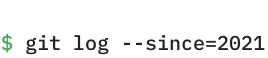
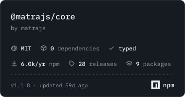
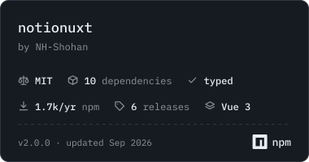
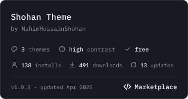

<p>
<a name="hero"><picture>
  <source media="(prefers-color-scheme: dark)" srcset="./assets/hero-dark.svg">
  <source media="(prefers-color-scheme: light)" srcset="./assets/hero-light.svg">
  
</picture></a>
</p>

<p align="center">
  <a href="https://nh-shohan.web.app/"><code>website</code></a> ·
  <a href="https://linkedin.com/in/nahim-hossain-shohan"><code>linkedin</code></a> ·
  <a href="mailto:nahim.hossain.shohan@gmail.com"><code>email</code></a> ·
  <a href="https://dev.to/nh-shohan"><code>dev.to</code></a> ·
  <a href="https://codepen.io/nh-shohan"><code>codepen</code></a> ·
  <a href="https://instagram.com/nahim.hossain.shohan"><code>instagram</code></a> ·
  <a href="https://fb.com/nahim.hossain.shohan.3"><code>facebook</code></a>
</p>

<h3><a name="heading-about"><picture>
  <source media="(prefers-color-scheme: dark)" srcset="./assets/heading-about-dark.svg">
  <source media="(prefers-color-scheme: light)" srcset="./assets/heading-about-light.svg">
  
</picture></a></h3>

```ts
const shohan = {
  role: 'Full-Stack & AI Engineer, UI/UX Designer',
  location: 'Dhaka, Bangladesh',
  experience: '3+ years building production SaaS',
  focus: 'LLM features that survive real users, and the guard rails around them',
  approach: 'own the product end to end: interface, API, data model, deploy',
  education: {
    degree: 'BSc in Computer Science and Engineering',
    university: 'American International University-Bangladesh',
    cgpa: '3.85 / 4.00',
    graduated: 2024,
    honors: [
      'Magna Cum Laude, for academic excellence',
      "Dean's List, every regular semester",
      'Academic Scholarship for Excellence',
    ],
  },
  speaks: ['Bangla', 'English', 'Hindi'],
  offline: ['drawing', 'travelling'],
  contact: 'nahim.hossain.shohan@gmail.com',
}
```

<h3><a name="heading-experience"><picture>
  <source media="(prefers-color-scheme: dark)" srcset="./assets/heading-experience-dark.svg">
  <source media="(prefers-color-scheme: light)" srcset="./assets/heading-experience-light.svg">
  
</picture></a></h3>

```text
2025 - now    Software Engineer    Genesys Software
2023 - 2024   Frontend Developer   Icebreakers
2023          Web Developer        Texium Solutions, USA (remote)
```

<h3><a name="heading-tools"><picture>
  <source media="(prefers-color-scheme: dark)" srcset="./assets/heading-tools-dark.svg">
  <source media="(prefers-color-scheme: light)" srcset="./assets/heading-tools-light.svg">
  
</picture></a></h3>

<p>
<a name="stack"><picture>
  <source media="(prefers-color-scheme: dark)" srcset="./assets/stack-dark.svg">
  <source media="(prefers-color-scheme: light)" srcset="./assets/stack-light.svg">
  
</picture></a>
</p>

<h3><a name="heading-work"><picture>
  <source media="(prefers-color-scheme: dark)" srcset="./assets/heading-work-dark.svg">
  <source media="(prefers-color-scheme: light)" srcset="./assets/heading-work-light.svg">
  
</picture></a></h3>

<table>
<tr>
<td width="50%" valign="top">

**[Rooktoo](https://rooktoo.vercel.app)** &nbsp;<sub>AI, web and mobile</sub><br>
A blood donation platform with an AI assistant on Gemini function calling: 9 tools, streamed replies, and access kept to least privilege behind auth and rate limits.<br>
<sub>`TanStack Start` `Convex` `Gemini` `WorkOS` `Expo`</sub>

</td>
<td width="50%" valign="top">

**[DoctorProjukti](https://doctor-projukti.vercel.app)** &nbsp;<sub>full-stack</sub><br>
A healthcare platform that connects patients, hospitals and pharmacies.<br>
<sub>`Next.js` `NestJS` `Prisma` `PostgreSQL`</sub>

</td>
</tr>
<tr>
<td valign="top">

**[TaskGrid](https://taskgrid.io)** &nbsp;<sub>at Genesys Software</sub><br>
A project management SaaS: boards, sprints, chat and a document editor, kept in sync in real time on the web and on phones.<br>
<sub>`Nuxt 3` `Vue 3` `Socket.io` `React Native` `MongoDB`</sub>

</td>
<td valign="top">

**[Pengine](https://pengine.io)** &nbsp;<sub>at Genesys Software</sub><br>
A print-on-demand storefront in Nuxt 4, with faceted search, payments and a design system built from Figma tokens.<br>
<sub>`Nuxt 4` `Vue 3` `Typesense` `Stripe` `Tailwind`</sub>

</td>
</tr>
<tr>
<td valign="top">

**[Matra](https://matrajs.com)** &nbsp;<sub>open source library</sub><br>
A headless rich text editor framework with React, Vue, Svelte and Solid bindings and zero runtime dependencies.<br>
<sub>`TypeScript` `npm`</sub>

</td>
<td valign="top">

**[notionuxt](https://notionuxt.vercel.app)** &nbsp;<sub>open source library</sub><br>
A drop-in Notion-style editor for Vue 3 on npm, with real-time collaboration and KaTeX math.<br>
<sub>`Vue 3` `Nuxt` `Y.js` `KaTeX`</sub>

</td>
</tr>
<tr>
<td valign="top">

**[create-3np-stack](https://github.com/NH-Shohan/create-3np-stack)** &nbsp;<sub>CLI</sub><br>
A scaffolding CLI that sets up Next.js and NestJS with API routes and the database connection ready.<br>
<sub>`Node.js` `npm`</sub>

</td>
<td valign="top">

**[Shohan Theme](https://marketplace.visualstudio.com/items?itemName=NahimHossainShohan.shohantheme)** &nbsp;<sub>design</sub><br>
A high-contrast VS Code theme in Dark, Light and Ocean.<br>
<sub>`VS Code`</sub>

</td>
</tr>
</table>

<h3><a name="heading-research"><picture>
  <source media="(prefers-color-scheme: dark)" srcset="./assets/heading-research-dark.svg">
  <source media="(prefers-color-scheme: light)" srcset="./assets/heading-research-light.svg">
  
</picture></a></h3>

<p>
<a name="research"><picture>
  <source media="(prefers-color-scheme: dark)" srcset="./assets/research-dark.svg">
  <source media="(prefers-color-scheme: light)" srcset="./assets/research-light.svg">
  
</picture></a>
</p>

<sub>Joint research with [Md. Jidanul Hakim Jitu](https://github.com/JH-Jitu), 2024.</sub>

<h3><a name="heading-journey"><picture>
  <source media="(prefers-color-scheme: dark)" srcset="./assets/heading-journey-dark.svg">
  <source media="(prefers-color-scheme: light)" srcset="./assets/heading-journey-light.svg">
  
</picture></a></h3>

<p>
<a name="journey"><picture>
  <source media="(prefers-color-scheme: dark)" srcset="./assets/journey-dark.svg">
  <source media="(prefers-color-scheme: light)" srcset="./assets/journey-light.svg">
  
</picture></a>
</p>

<details>
<summary><code>the same, as text</code></summary>

```text
2021      22 repos           learning the web
2022-23   14 repos           Java, Oracle, Python
2024      Shohan Theme       a VS Code theme
2024      create-3np-stack   a full-stack app from one npx
2025      TaskGrid           project management, in real time
2025      notionuxt          a Notion-style editor for Vue
2025      Pengine            a print-on-demand storefront
2025      Rooktoo            blood donation, with an AI assistant
2026      DoctorProjukti     a healthcare ecosystem
2026      Matra              a rich text editor framework, from scratch   HEAD -> main
```

</details>

<h3><a name="heading-activity"><picture>
  <source media="(prefers-color-scheme: dark)" srcset="./assets/heading-activity-dark.svg">
  <source media="(prefers-color-scheme: light)" srcset="./assets/heading-activity-light.svg">
  
</picture></a></h3>

<p>
<a name="activity"><picture>
  <source media="(prefers-color-scheme: dark)" srcset="./assets/activity-dark.svg">
  <source media="(prefers-color-scheme: light)" srcset="./assets/activity-light.svg">
  
</picture></a>
</p>

```
$ git status
On branch main
Changes not staged for commit:
  modified:   the web, one product at a time

$ git commit -m "be the best version of yourself"
```

<h3><a name="heading-badges"><picture>
  <source media="(prefers-color-scheme: dark)" srcset="./assets/heading-badges-dark.svg">
  <source media="(prefers-color-scheme: light)" srcset="./assets/heading-badges-light.svg">
  
</picture></a></h3>

<p align="center">
  <a href="https://mcprush.com/to/matra-mcp?ref=badge"></a>
  <a href="https://www.npmjs.com/package/@matrajs/core"></a>
  <br>
  <a href="https://www.npmjs.com/package/notionuxt"></a>
  <a href="https://marketplace.visualstudio.com/items?itemName=NahimHossainShohan.shohantheme"></a>
</p>

<p align="center">
  <a href="https://www.npmjs.com/package/@matrajs/core"></a>
  <a href="https://www.npmjs.com/package/@matrajs/mcp"></a>
  <a href="https://github.com/amrelaco/matra#licence"></a>
  <a href="https://github.com/amrelaco/matra"></a>
  <br>
  <a href="https://www.npmjs.com/package/notionuxt"></a>
  <a href="https://www.npmjs.com/package/notionuxt"></a>
  <a href="https://www.npmjs.com/package/create-3np-stack"></a>
  <br>
  <a href="https://marketplace.visualstudio.com/items?itemName=NahimHossainShohan.shohantheme"></a>
  <a href="https://marketplace.visualstudio.com/items?itemName=NahimHossainShohan.shohantheme"></a>
  <a href="https://socket.dev/npm/package/@matrajs/core"></a>
</p>
